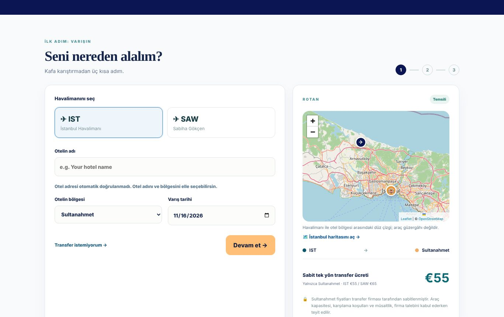

<div align="center">


# Bosphorly

**Istanbul, made simple.**

*Mobile-first arrival planning · Istanbul discovery · Ethical travel intermediation*

[▶ Canlı demo](https://erenariel.github.io/Bosphorly/) · [Traveler demo (English)](https://erenariel.github.io/Bosphorly/?lang=en) · [Tour comparison](prices.html) · [Interactive Istanbul map](map.html) · [Product presentation](presentation.html) · [Partner dashboard preview](dashboard.html) · [Roadmap](docs/ROADMAP.md)
</div>

## ▶ Canlı demoyu aç

**[Bosphorly ana sayfasını ve transfer formunu aç →](https://erenariel.github.io/Bosphorly/)**

Demo, bu deponun `main` dalından GitHub Pages ile otomatik yayınlanır; `main`e giren her değişiklik birkaç dakika içinde burada görünür. Site, ziyaretçinin cihaz dilinde açılır (23 dil); dil menüden değiştirilebilir. Giriş gerektirmez. Formlar talebi WhatsApp mesajı olarak hazırlar; misafir WhatsApp’ta “Gönder”e basınca talep Bosphorly WhatsApp hattına ulaşır. Sitede ödeme alınmaz. Bilgiler sunucuda saklanmaz; misafirin profili ve talepleri yalnızca kendi cihazında, [Hesabım](account.html) sayfasında tutulur. Fiyatlar istenirse TCMB günlük kuruyla başka para biriminde gösterilir.

[](https://erenariel.github.io/Bosphorly/#booking)

[Transfer formu](https://erenariel.github.io/Bosphorly/#booking) · [Tur karşılaştırma](https://erenariel.github.io/Bosphorly/prices.html) · [İstanbul haritası](https://erenariel.github.io/Bosphorly/map.html) · [English](https://erenariel.github.io/Bosphorly/?lang=en)


> **How Bosphorly works:** Bosphorly is a referral intermediary, the hotel reception's tour brochure desk moved online. Travelers compare licensed Istanbul tour and transfer companies and send a request through Bosphorly; the company confirms and delivers the service; in the current hotel pilot the guest pays in cash at the hotel reception (cash only; tour companies add 10% on card payments); Bosphorly earns a contracted commission from the company for each completed referral. Hotels can join as referral partners. Details: [business model](docs/BUSINESS-MODEL.md).

> **Public prototype · 16 November 2026.** This is not a live agency, payment service, reservation engine, or partner portal. No bookings or charges are made. All demo prices, provider cards, referral KPIs, commissions and sample transactions are illustrative or third-party research, **not confirmed commercial offers**.

## What is available

- 📱 **Mobile-first traveler concept**: selectable arrival airport, hotel zone, skip-transfer action, multi-step form preview and 12 draft language locales (TR, EN, RU, UK, DE, FR, NL, AR, HE, AZ, FA, ES). Some UI strings need human review.
- 🗺️ **Istanbul discovery map**: 14 landmark/airport/neighborhood pins, search and filters, with public OpenStreetMap/Leaflet tiles when internet is available **and a built-in offline schematic fallback** when map tiles cannot load.
- 🚇 **Transport pointers**: links to official M11, M4 and tram service sources. Not real-time journey planning; do not assume listed station changes or service times are current.
- 🎟️ **In-platform request journey**: travelers stay on Bosphorly until they send a request, so every referral carries a Bosphorly reference code; there are no redirects to supplier checkouts. Payment is made to the company, not to Bosphorly. `data/offers.json` is an internal catalog of draft products; a price becomes requestable only after the company has approved it in a signed agreement.
- 🏨 **Partner console (illustrative)**: responsive presentation of synthetic referral counts, company commissions, hotel shares and a readiness checklist, without real bookings or customer data.
- ✨ **Product presentation**: vision for travelers, hotels, licensed travel suppliers and the proposed commission model.
- 🔎 **SEO and publishing foundations**: accessible structure, plain-language disclosures, source links and an editorial strategy.
- 🛡️ **Security boundaries**: never enter actual card/passport details or customer information into prototype forms.

## Repository structure

```text
index.html             Standalone mobile-first traveler demo
booking.html           In-platform booking preview (not a real reservation)
booking.js             Local-only booking validation and catalog integration
booking.css            Responsive booking styles
data/offers.json       Draft referral catalog and fixed Sultanahmet transfer tariffs
data/public-market-prices.json   Source-checked public operator prices (for comparison)
prices.html            Published operator prices page (not Bosphorly offers)
prices.js              Local price filter and rendering
hotel-lookup.js        Optional Google Places hotel matching
config/maps-public.js  Restricted browser-only Google Maps key configuration
map.html               Istanbul map and transport information
presentation.html      Product vision and investor/partner presentation
presentation.css       Presentation styling
dashboard.html         Public synthetic partner console
dashboard.css          Dashboard responsive styling
dashboard.js           Demo-only tab and filter logic
assets/brand/           User-selected compact logo + fallback vector icon
assets/maps/            Istanbul schematic fallback map
docs/BUSINESS-MODEL.md Referral intermediary model, commissions and agreements
docs/PRODUCT.md        Core product and personas
docs/ROADMAP.md        Delivery phases
docs/SEO.md            Destination-content strategy
docs/LEGAL-GATES.md    Compliance, privacy and legal checks
tools/check_site.py     JS, internal-link, pricing and redirect smoke tests
BRAND.md               Brand direction
PROJECT_BRIEF.md       Extended original project brief
SECURITY.md            Responsible reporting and prototype security
CONTRIBUTING.md        Contribution guidelines
.github/workflows/     Quality check and Pages publishing
```


## New Istanbul guide library

Original English and Turkish visitor articles (editorial prototypes, not live operator information):

- [English Istanbul travel guide](en/istanbul-guide.html) · [Türkçe İstanbul rehberi](tr/istanbul-rehberi.html)
- [IST and SAW airport transfers](en/airport-transfer.html) · [Havalimanı transferi](tr/havalimani-transferi.html)
- [Metro and public transport](en/public-transport.html) · [Toplu taşıma](tr/toplu-tasima.html)
- [Byzantine and Ottoman Old City](en/old-city.html) · [Tarihî Yarımada](tr/tarihi-yarimada.html)
- [Bosphorus cruises](en/bosphorus-cruises.html) · [Boğaz turları](tr/bogaz-turlari.html)

Editorial location and rail reference records: [places](data/places.json) · [rail lines](data/rail-lines.json). These are not live map routing or transit feeds.

## Local preview

Open `index.html` in a browser or run a local static server:

```bash
python3 -m http.server 8000
```

Then visit `http://localhost:8000/`. Interactive map tiles need access to OpenStreetMap and Leaflet CDNs.

## Deploy

Go to **Settings → Pages → Build and deployment** on this repository, select **GitHub Actions** as the source, and check the `Deploy Bosphorly public prototype` workflow. Publishing is only complete when GitHub Pages reports a live URL.

## Planned next milestones

Legal review of the referral model; signed commission agreements and licence checks with tour/transfer companies (starting with the Sultanahmet transfer); request form with Bosphorly reference codes; company confirm/decline flow; monthly coded-sales reconciliation and commission invoicing; hotel referral shares; Google Places and service zones; professionally reviewed localized editorial guides.

See [business model](docs/BUSINESS-MODEL.md), [product spec](docs/PRODUCT.md), [roadmap](docs/ROADMAP.md) and [legal gates](docs/LEGAL-GATES.md).

## Separation from KonaklamaFlow

**Bosphorly and KonaklamaFlow are independent projects.** Never transfer hotel guest records, tokens, production credentials, private contracts or source code between them without explicit authority and a separate privacy/security review.

## Brand

The original selected visual direction is a white **B**, aqua flight trail and historic gold forms on midnight blue. The public website uses a small optimized crop of the user-selected artwork (`assets/brand/approved-icon.webp`). The separate SVG remains an approximate fallback, not the master vector logo. Full-size image exports are retained outside the public repo pending final brand packaging.

© 2026 Bosphorly concept. Brand name, domain and trademark availability require verification.

## In-platform request policy (November 2026)

Every traveler experience card leads to `booking.html?service=<approved-id>`, where the traveler sends a request through Bosphorly. The public catalog **must not link out to company checkouts**: the request has to go through Bosphorly so that it carries a Bosphorly reference code, which is what the commission is reconciled against. Requestable prices are the ones each company has approved in its agreement; the static `data/offers.json` is a read-only demonstration and **not a trusted price source**.

Forwarding real requests, reference codes, passenger details, commissions and customer messages all require a secure backend and a separate legal/operational release gate. Bosphorly does not take card payments in this model. Codex implementation brief: [Issue #1](https://github.com/erenariel/Bosphorly/issues/1).


## Traveler pricing and browser localization (16 Nov 2026)

- **Sultanahmet airport transfers are fixed**, not estimated, at **IST → Sultanahmet €55** and **SAW → Sultanahmet €65**, one way. These are the transfer company's own retail tariffs; the traveler pays the company, and Bosphorly's commission comes from the company. Other destinations remain `Ask for price`. Real reservations remain disabled until fulfillment is integrated.
- **36 sourced operator records** (35 advertised prices and one rate-on-request) are in `data/public-market-prices.json`. Comparing companies' published prices is part of the product. Until a company signs an agreement, its price is shown with its source and check date, marked **published by the operator, NOT a Bosphorly offer**, and cannot be requested. Dates/packages/seasonal discounts can change, so records must be re-checked regularly.
- On first launch, the traveler's interface detects the browser language via `navigator.languages`. A manually chosen language is remembered for subsequent visits.
- **23 languages, site-wide:** Turkish, English, Russian, Ukrainian, German, French, Dutch, Arabic, Hebrew, Azerbaijani, Persian, Spanish, Italian, Portuguese (Brazil), Croatian, Hungarian, Bosnian, Chinese (Simplified, Mandarin), Japanese, Korean, Hindi, Bengali and Indonesian. Each covers the home page, request page (tours and hammam), My account, tour comparison, the WhatsApp message and every tour record's title, details and options. Arabic, Hebrew and Persian render right-to-left. Translations other than Turkish/English are drafts and should be reviewed by native speakers before launch.
- **Discover Istanbul** (`explore.html`): 33 places to visit (palaces, museums, bazaars, neighbourhoods, Isfanbul (ex-Vialand), Istanbul Aquarium at Aqua Florya, SEA LIFE, LEGOLAND, whirling dervishes and more) with category filters, map, closing days, indicative prices with their source, official sites, directions and a WhatsApp “ask us” button. Prices are indicative and dated; sources disagree, so they must be re-checked regularly.
- **Prof. İlber Ortaylı's walking route** (`route.html`): 13 stops from Eminönü to Sultanahmet over two days, compiled from Turkish press reports (linked on the page), with a numbered map and Google Maps walking directions. It is not an official or endorsed route.
- **Site search** (`search.html`, magnifier in the header) covers tours, places, the route and guides in every language and old names (e.g. “Vialand”, “Aqua Florya”, “kapalıçarşı”).
- **Membership and coupons** (built, not yet deployed): sign-in by e-mailed code, welcome / hotel / second-tour / referral / loyalty coupons funded from Bosphorly's commission, coupon on the request form, partner check-in page. See [docs/MEMBERSHIP.md](docs/MEMBERSHIP.md).
- Discover texts live in `tools/discover-src/` (master + one file per language); run `python3 tools/build_discover.py` to rebuild `data/discover/`.
- Optional Google Places (New) autocomplete identifies a selected Istanbul hotel by its name, formatted address and location. Without a configured restricted browser key, a clearly marked manual fallback remains available. See [Google Places activation](docs/GOOGLE-PLACES.md).
- The homepage includes subtle animated water flourishes through CSS, respecting the visitor's reduced-motion preference. No heavy animated GIF is required.

**Data rule:** A company's published list price must never silently become a requestable price. Only prices the company has approved in a signed agreement can be requested, and they must not exceed what the traveler would pay the company directly (price parity). Price approvals and request forwarding need the secure backend planned in Issue #1.
