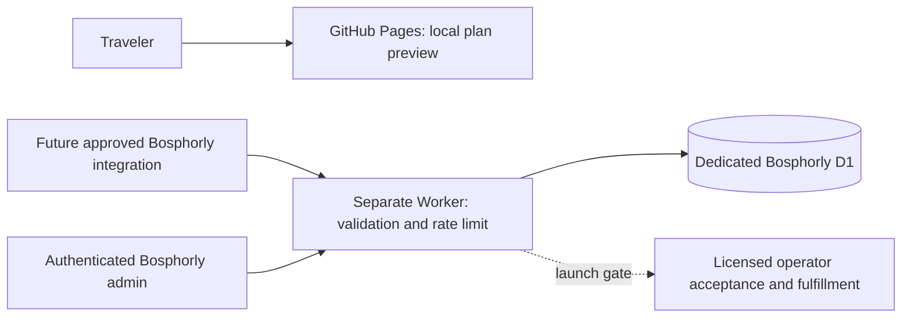

# Phase 1: separate booking foundation

The GitHub Pages demo remains local-only. No backend URL is configured in the
browser. `booking-adapter.js` produces an in-memory draft; it never submits,
persists, contacts a supplier or creates a reservation. Static catalog values
cannot become actionable quotes. Existing brand assets, guides and map remain.

## API and authority

- `POST /v1/quotes`: accepts only experienceId, ISO date and integer guests 1–16.
  Reads verified supplier, approved rate in supplier currency and fresh dated
  availability. Returns only currency/retail total in integer minor units or
  `quote_required`. A quote does not reserve capacity or confirm a booking.
- `POST /v1/requests`: always 503, before body parsing or DB access. No enable
  flag exists. Separate approval and implementation are required to collect data.
- `POST /v1/admin/providers/verify`: admin bearer token required; id,
  licenseReference and sourceReference record operator verification evidence.
- `POST /v1/admin/prices`: admin bearer token required; id, experienceId,
  currency, unitMinor, validFrom, validUntil, sourceReference. Only verified
  suppliers with matching currency can receive rates. New immutable rate IDs
  preserve history. Corrections require another rate. Missing matching rows
  return updated:0. Never supply wholesale or commission fields to travelers.

Bearer authentication uses a dedicated server secret; no cookies means no
ambient cookie CSRF authority. Exact browser Origin allowlist and managed rate
limiting fail closed. Non-browser clients still require admin authentication.
Do not put the admin secret in frontend JavaScript. Admin is the only role that
can approve suppliers/pricing; operator state transitions are a domain contract,
not an exposed endpoint. No traveler can transition a booking. Audit events
contain route identifiers and actor roles, not request bodies or IP addresses.
Use opaque internal references, never names/emails, in evidence fields.

## States, referral and commissions

`domain.js` defines all permitted edges and requires authenticated admin/operator
role plus evidence. Inquiries remain draft/requested/supplier_pending until
operator acceptance; fulfillment requires its own evidence. No transition API is
enabled in Phase 1. SQL is private to the service; future write APIs must use the
state guard and atomically append events with compare-and-set updates.

Future request processing must compute a server quote again, atomically consume
capacity, snapshot approved price, currency and commission basis points, and
bind a unique idempotency key to a canonical payload hash. A reused key with a
different payload must return 409; identical retries return the original result.
No such processing or confirmed reservations are enabled here.

Issue cryptographically random opaque hotel codes (at least 128 bits), store
only SHA-256 hashes, enforce expiry/revocation and verified hotel at attribution,
and never trust hotel IDs or commission rates from clients. Do not infer a
referral from arbitrary query parameters. Bind attribution once per request;
check self-referrals, code replay/abuse, staff incentives and refund fraud during
manual reconciliation. No cross-project identity or database sharing.

The schema accrues commission only against a matching fulfilled request and
fulfillment event, matching hotel/currency and snapshotted basis points. Refund
pending/refunded states reverse accrual (including reconciled records); actual
payout clawback needs an auditable reversal event and reconciliation reference.
Partial refunds, disputes, taxes and payout execution are deferred; do not use
this schema as a production financial ledger without those policies and tests.

## Deployment and migration

Use a dedicated Cloudflare account environment, D1 database and Worker separate
from Pages. No real keys or rates are included. Do not deploy to production yet.
For approved staging: install Wrangler, create a new dedicated D1 database, set
its ID in `backend/wrangler.jsonc`, run `wrangler d1 migrations apply
bosphorly-booking --local --config backend/wrangler.jsonc` first, then apply to
staging with `--remote`. Configure PUBLIC_ORIGIN to the exact Pages origin and
set ADMIN_TOKEN with `wrangler secret put` per environment. Configure a staging
route deliberately; workers.dev is disabled. Never commit `.dev.vars`.

The migration is additive and unseeded: no invented prices/availability. Back up
D1 before subsequent migrations; test restoration in staging. Roll back Worker
code separately; never drop financial/audit tables as a rollback strategy.

## Launch gates

Bosphorly runs as a referral intermediary (see BUSINESS-MODEL.md): requests
are forwarded to the licensed company, which confirms and collects payment.
Before enabling requests or collecting even email/phone: obtain separate owner
approval, confirm the referral model's licensing position, verify each company
and its signed commission agreement, complete KVKK privacy notice (naming the
companies that receive the details)/retention/access/deletion review, and
publish specific cancellation/refund and consumer terms. Before confirmation: implement operator
acceptance evidence, capacity concurrency, request idempotency and signed quote
expiry. Bosphorly does not collect payments in the referral model; doing so later
would be a separate business decision needing licensing, payment compliance/PCI
review and an approved provider integration. Never collect raw cards or
passports. No
emails, supplier connections, payments, customer storage or production launch
are enabled by this PR. The request must be sent through Bosphorly so it
carries a Bosphorly reference code; never a redirect to a company checkout.

Run `npm ci && npm test`, then `npx playwright install chromium` and
`npm run test:mobile`. Mobile smoke covers 360/390/768, draft state, RTL layout,
logo, storage/network collection and offline map rendering. Tests use synthetic
rates exclusively, never live supplier data.
